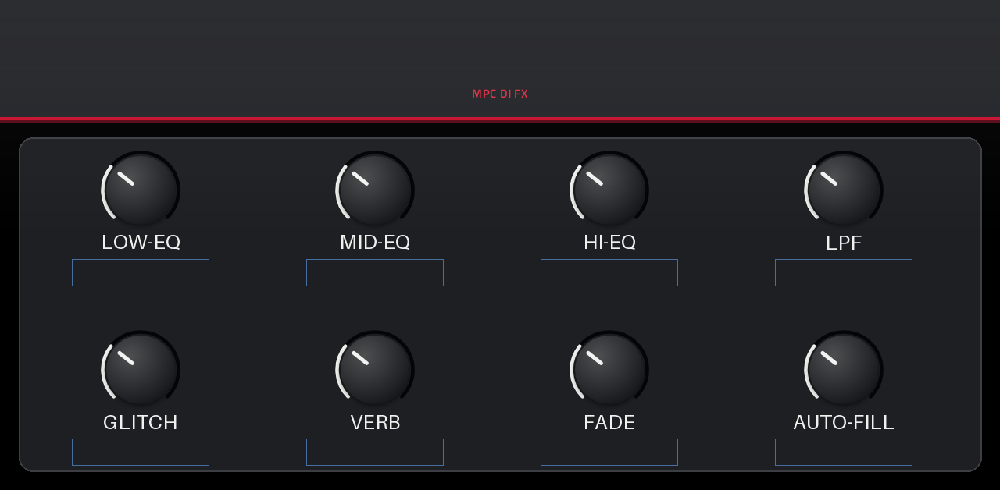
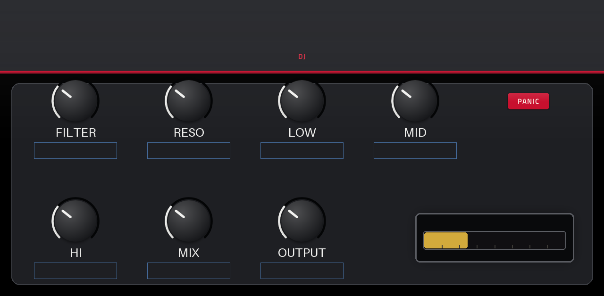

# MPC DJ FX

A one-slot live DJ effect for Akai MPC and Force standalone devices: 3-band isolator, DJ filter,
beat repeat, delay, reverb, through-zero flanger and a limiter, plus one macro knob that moves a
curated set of them together.


## The problem

An MPC in standalone mode has no DJ performance strip. You can put a filter on a pad, but a live set
needs the whole rack in one place: on one insert slot, with the Q-Links under your hands. Kill the low
end, throw a beat repeat, smear the tail, and come back in on the one.

MPC OS 2.x and 3.x contain a VST2 host, so a native insert effect can do this without a laptop. This
plugin is that effect.

## What it does

One insert effect, 40 parameters, seven stages in series:

| Stage | Controls | Notes |
| --- | --- | --- |
| 3-band isolator | low, mid, high, two crossover frequencies | Shelving design. Transparent at 0 dB, about 59 dB of kill (measured offline in the unit tests). |
| DJ filter | cutoff, resonance | One knob from low-pass to high-pass through neutral. |
| Beat repeat | mode, gate, chance, slice count, mix | Tracks the host tempo. |
| Delay | time, sync, division, feedback, tone, ping-pong | Free or tempo-synced. |
| Reverb | mode, amount, decay, damping, pre-delay | Plate and hall. |
| Through-zero flanger | rate, depth, feedback, mix | The flanger is also the "glitch" colour of the macro knob. |
| Limiter + output | limiter, output gain | Sits at the end of the chain. |

The macro layer (`Macro` page) maps one hardware knob onto a curated set of parameters: low, mid and
high kill, LPF, glitch, reverb, fade and fill. That is the control you ride during a set.

The skin uses the framework's `layout.conf` format, so every page and every Q-Link assignment is
readable and editable in a text file (`vst/layout.conf`).

## Screens

Rendered from the layout, no device needed (`vst/preview.sh`):

| Page | Image |
| --- | --- |
| 0 |  |
| 1 |  |

## Status

**v1.0.1, frozen.** Device tested on an MPC Live II running MPC OS 3.9.1.2 (2026-10-26, recorded in
`tested.json`). The release artifact passes the framework's catalog checks (`catalog_check.py`, no warnings)
and carries the CPU measurement below.

1.0.1 is a wrapper change only: the plugin now tells the framework's bench which of its parameters are
one-shot triggers, so `panic` is measured as a tap instead of being swept like a knob. The audio path is
unchanged.

A successor is in development (`DjFx2`, uid `DjF2`, a separate plugin). It adds the original rack's
grain stage, a true-peak limiter and a moving fade band. v1 stays frozen on purpose: it stays
installed on the device so both versions can be compared side by side. See [ROADMAP.md](ROADMAP.md).

## CPU

Measured on the device with the framework's bench (128 frames at 44.1 kHz = 2902 µs per block), on the
same binary this release ships (md5 `6d7f8a12bc098764a27baa7330ceab48`):

| Stage | mean | p99 | worst block |
| --- | --- | --- | --- |
| idle | 5.7 % | 6.6 % | 8.1 % |
| audio in | 5.7 % | 6.4 % | 8.3 % |
| Q-Link sweep | 6.6 % | 7.4 % | 7.8 % |
| release tail | 6.0 % | 6.6 % | 7.2 % |
| trigger fire (`panic`) | 6.8 % | 35.6 % | 64.4 % |

**Verdict: PASS.** Several instances run alongside a normal project.

The last row is the panic button, fired once. It clears the delay and repeat buffers (about 9 MB) across
three staged blocks with the output muted, which is what a panic button is for. That cost belongs to the
trigger, not to the controls, so the bench reports it in its own stage and it does not decide the verdict.
Riding the Q-Links costs 7.4 % p99.

## Install

Download the zip from [Releases](https://github.com/mitchoster/mpc-vst-djfx/releases), unpack it on the
device and run `install.sh` as root. The installer stops MPC, backs up `MPC.settings`, copies the plugin
folder and restarts MPC. `uninstall.sh` reverses it.

The release is built for **MPC OS 3.x only**. Its skin uses TUI format version 2, which MPC OS 2.x cannot
read: the plugin would load, but its touchscreen pages would not appear.

Requirements: an MPC or Force with root SSH enabled.

## Build

Requirements: Docker, and a checkout of the porting framework
[`sd88me/mpc-vst-plugins`](https://github.com/sd88me/mpc-vst-plugins) (MIT). The framework supplies the
VST2 wrapper, the parameter generator and the skin tooling.

```bash
git clone https://github.com/sd88me/mpc-vst-plugins
export MPC_VST_PLUGINS="$PWD/mpc-vst-plugins"

vst/test.sh             # offline x86 host test under ASan/UBSan, must print PASSED
vst/build.sh            # cross-compiles for arm32v7 -> vst/build/mpc_djfx.so + skin folder
vst/tests/run.sh        # unit tests: isolator, repeat, flanger, limiter, macro
```

The build container is `arm32v7/gcc:11-bullseye`, because MPC OS links against glibc 2.32. The
framework's `docs/PORTING.md` covers deploying to the device and registering the plugin, which needs
root SSH on the MPC and one MPC restart.

If your Docker daemon runs on another host and only sees host-visible paths, translate `$PWD` before
handing it to the framework.

## Tested limits

These are known gaps, not surprises:

- The macro's "glitch" position reuses the flanger. The original rack has a separate grain stage.
- The limiter has no true-peak detection.
- "Fade to grey" is a shelf kill, not a band that moves across the spectrum.
- The macro curves were tuned by ear, not measured against the original rack.

`DjFx2` addresses the first three and measures the fourth.

## License

MIT, see [LICENSE](LICENSE). Vendored third-party code keeps its own licence and is listed in
[THIRD_PARTY_NOTICES.md](THIRD_PARTY_NOTICES.md); hashes and exact upstream commits are in
`vst/src/VENDORED.md`.

Not affiliated with Akai Professional or inMusic. Product names are used only to say what this
plugin runs on.
